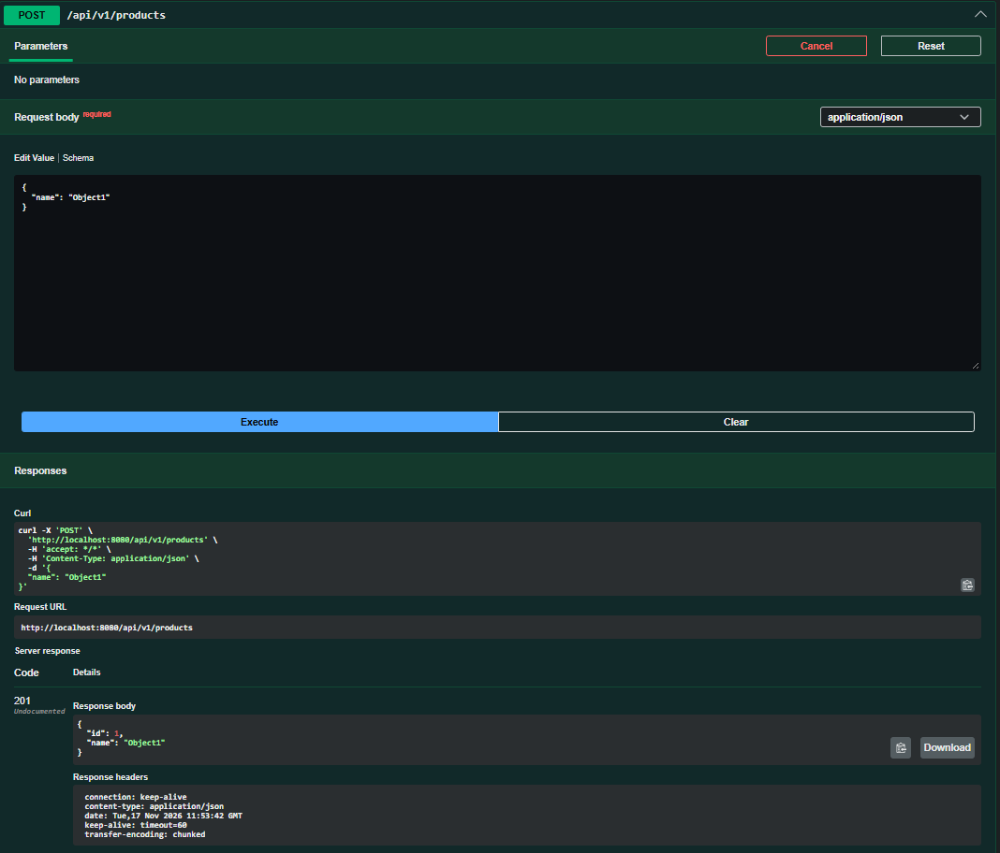
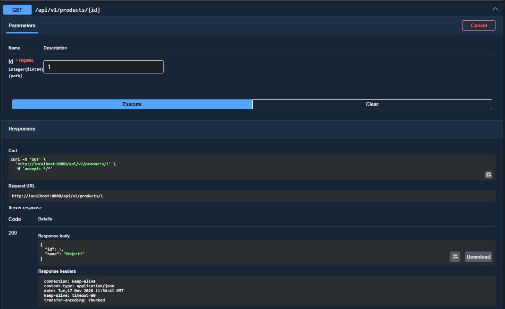
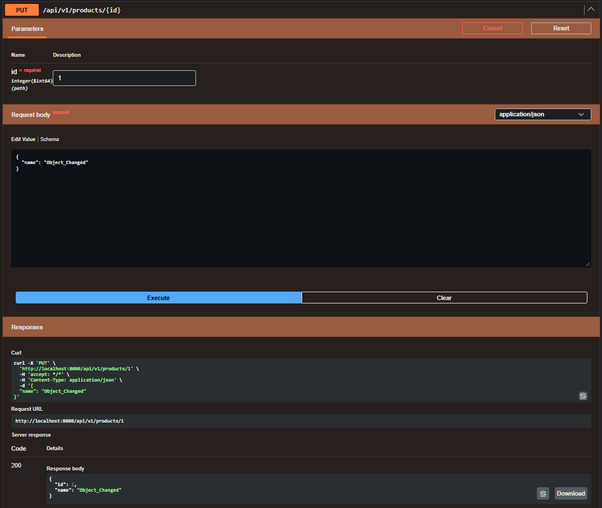
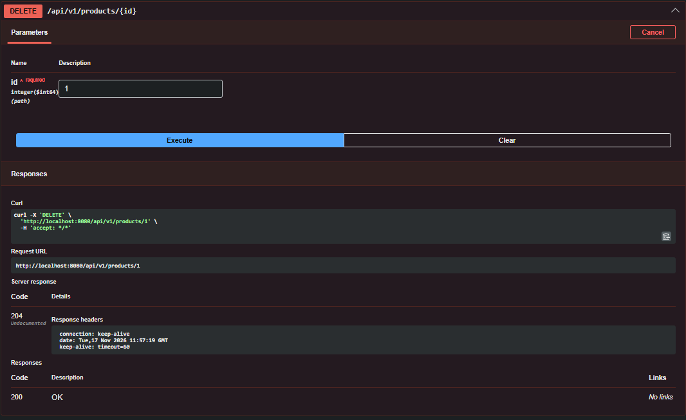

# FirstRestAPI

A simple REST API for managing products (CRUD), built with Spring Boot.

## Tech Stack

- Java 17
- Spring Boot 4.1.2 (Web, Data JPA)
- H2 in-memory database
- springdoc-openapi (Swagger UI)
- Maven

## Running

Requires JDK 17+.

```bash
./mvnw spring-boot:run
```

The app starts on `http://localhost:8080`.

- Swagger UI: http://localhost:8080/swagger-ui.html
- H2 Console: http://localhost:8080/console/ (JDBC URL: `jdbc:h2:mem:testdb`, user `sa`, empty password)

> The database is in-memory — data resets on restart.

## API Endpoints

Base path: `/api/v1/products`

| Method | Path | Description | 
|---|---|---|
| `POST` | `/api/v1/products` | Create a product | 
| `GET` | `/api/v1/products/{id}` | Get a product by id | 
| `PUT` | `/api/v1/products/{id}` | Update a product's name | 
| `DELETE` | `/api/v1/products/{id}` | Delete a product |

### Example

```bash
curl -X POST http://localhost:8080/api/v1/products \
  -H "Content-Type: application/json" \
  -d '{"name": "Coffee"}'
```

Request/response body:

```json
{ "id": 1, "name": "Coffee" }
```

## Tests

```bash
./mvnw test
```
## Examples

### 1. Create a product (POST)

Creating a product via the Swagger UI "Try it out" panel:



### 2. Get a product by id (GET)

Retrieving a product by its id:



### 3. Update a product's name (PUT)

Updating a product's name via the Swagger UI "Try it out" panel:



### 4. Delete a product (DELETE)

Deleting a product and the resulting response:


